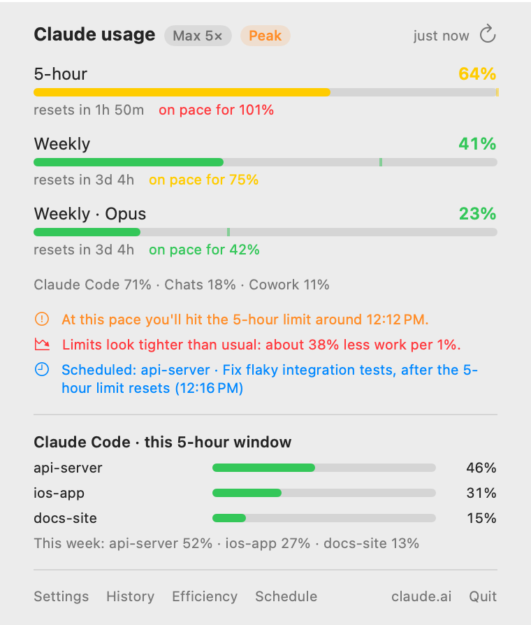
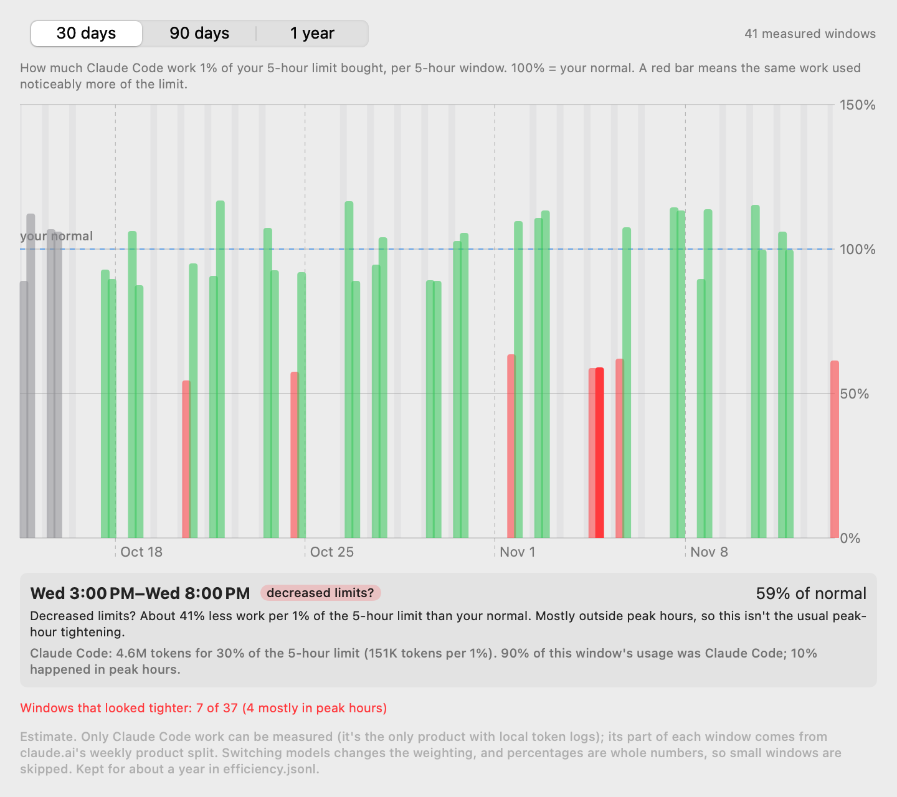
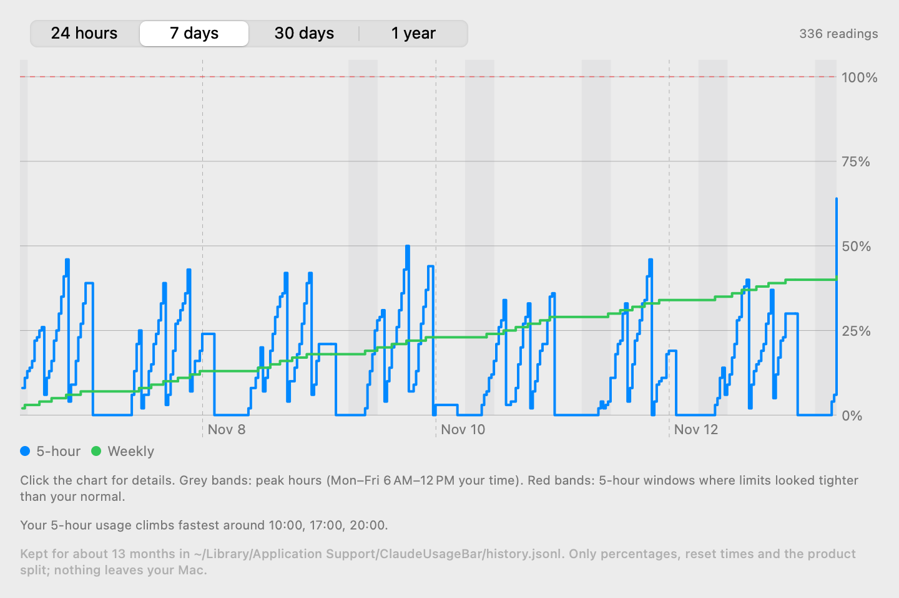

# Claude Usage (menu bar)

A macOS menu-bar app that shows your claude.ai usage limits and per-chat token stats. It is a
re-implementation of the logic in [lugia19/Claude-Usage-Extension](https://github.com/lugia19/Claude-Usage-Extension).

> **Unofficial.** Not affiliated with or endorsed by Anthropic. It reads your usage from claude.ai's
> own web endpoints (the same ones the website uses), which are undocumented and can change or break
> at any time. Use at your own risk. Built with [Claude Code](https://claude.com/claude-code), reviewed and tested.

**Why a menu-bar app rather than an overlay inside Claude Desktop?** The original plan was to inject
the tracker into Claude Desktop over the Chrome DevTools Protocol. Claude Desktop 4.16336.0 refuses
to start when any remote-debugging switch is present, and getting past that would mean patching the
app, which this project won't do. [FEASIBILITY.md](FEASIBILITY.md) has the evidence. The fallback is
this standalone app. It never touches `/Applications/Claude.app`.

Background research on the extension (endpoints, response shapes, token and caching math) is in
[RESEARCH.md](RESEARCH.md).

<picture>
  <source media="(prefers-color-scheme: dark)" srcset="docs/screenshots/popover-dark.png">
  
</picture>
<picture>
  <source media="(prefers-color-scheme: dark)" srcset="docs/screenshots/efficiency-detail-dark.png">
  
</picture>

<picture>
  <source media="(prefers-color-scheme: dark)" srcset="docs/screenshots/history-dark.png">
  
</picture>

<sub>Screenshots use made-up demo data (`macos/scripts/screenshots.sh`).</sub>

---

## Install

### Download

1. Get `ClaudeUsage-<version>.zip` from the [latest release](../../releases/latest) (Apple Silicon and Intel, macOS 14+).
2. Unzip it and move **ClaudeUsageBar.app** to Applications.
3. **First launch:** the app isn't notarized (that needs a paid Apple developer account), so macOS
   blocks it the first time. Open it once, then go to **System Settings → Privacy & Security**, scroll
   down to "ClaudeUsageBar was blocked", and click **Open Anyway**. Or in Terminal:
   ```bash
   xattr -dr com.apple.quarantine /Applications/ClaudeUsageBar.app
   ```
   Either way, only do this for a copy you downloaded from this repository's releases.

### Build from source

Requires macOS 14+ and Xcode (or the Swift 6 toolchain).

```bash
cd macos
swift test                      # unit tests
scripts/bundle.sh --install     # builds, ad-hoc signs, copies to ~/Applications/ClaudeUsageBar.app
open ~/Applications/ClaudeUsageBar.app
```

On first launch a login window opens on claude.ai. Sign in as usual. Once claude.ai sets its
`sessionKey` cookie, the window closes and a dot plus a percentage appear in the menu bar.

- **Start at login:** turned on automatically the first time the app runs. Turn it off in Settings → Menu bar
  ("Start Claude Usage when I log in"), or in System Settings → General → Login Items.
- **The app is called "Claude Usage"** (file: `~/Applications/ClaudeUsageBar.app`). Open it from Spotlight; quit it
  from the popover's Quit button.
- **Notifications:** allow them when macOS asks. If you dismissed the prompt, Settings shows
  "macOS is blocking notifications" with a button to fix it.
- **Keychain prompt after a rebuild:** the app is ad-hoc signed, so each rebuild has a new signature.
  macOS may ask once whether to allow access to the saved session. Choose *Always Allow*.

## Uninstall / back to stock

Nothing about Claude Desktop is changed, so there's nothing to revert: just launch Claude normally.
To remove this app:

```bash
rm -rf ~/Applications/ClaudeUsageBar.app ~/Library/Application\ Support/ClaudeUsageBar
security delete-generic-password -s local.claude-usage-bar -a sessionKey
security delete-generic-password -s local.claude-usage-bar -a anthropicAPIKey
defaults delete local.claude-usage-bar
# only if you set up "Keep running with the lid closed":
sudo rm -f /etc/sudoers.d/claude-usage-bar && sudo pmset -a disablesleep 0
```

---

## What it shows

**Menu bar.** A dot for the 5-hour window: green below 50 %, yellow 50–80 %, red above 80 %. The
percentage next to it is optional (Settings → Menu bar).

**Popover**
- **Every usage window `/usage` returns**, rendered generically: the session (5 h), weekly, per-model
  weekly windows, and any new kind claude.ai adds later, labelled from its key. Each one shows a
  bar, the percentage, a reset countdown, and a **pace** projection.
- **Pace** is a linear extrapolation of your rate so far in the window to its reset time. It can go
  above 100 %; when it does, the row also shows when you'd hit 100 %.
- **Extra usage / credits**, in dollars, when enabled on the account.
- **Usage by product**, e.g. "Weekly by product: Claude Code 51% · Cowork 49%", from any `*_breakdown`
  field claude.ai returns. The per-chat stats only cover the *Chats* share. Claude Code and Cowork
  usage counts toward your limits but isn't broken down per session here.
- **Recent chats** (default 5). For each chat:
  - context length and its breakdown by source
  - estimated cost of the next message, as a share of the 5-hour budget
  - cache status and "messages left"
- Every number has a tooltip explaining it.

**Notifications** (native, from the app):
- A warning at each threshold you set (default 80 % and 95 %), once per window per reset period.
- "5-hour limit has reset", scheduled for the reset time, so it fires even if the Mac was asleep.
  By default it's only sent if you reached a warning threshold in that window.
- A heads-up if a Claude Desktop update stops refusing debugging switches (see Robustness).

**Pace line** at the top of the popover: "At this pace you'll hit the 5-hour limit around 15:40" (orange)
or "…end the 5-hour window around 60 %. Room for a big task." (green), for the 5-hour and weekly limits.

**Claude Code by project.** Claude Code writes the exact token usage of every API call to its logs in
`~/.claude/projects`. The app reads those locally and shows which projects used the most in the
current 5-hour window, the last 24 hours, and this week (popover shows the top 3, **History → Claude
Code** shows all). It reads only the token counts, never the message text, and sends nothing anywhere.
Cowork runs in the cloud and keeps no local logs, so it can't be split this way.

**History** (popover → History): a chart of every limit over 24 h / 7 d / 30 d, plus the hours your
5-hour usage climbs fastest. Kept for 30 days in `history.jsonl` (percentages and times only).

**Efficiency** (popover → Efficiency): long-term tracking of how much Claude Code work 1 % of your
5-hour limit buys, per 5-hour window, compared with your own normal (the median of your earlier
windows over 60 days). A window where the same work used noticeably more of the limit (below 70 % of
normal) is flagged **"Decreased limits?"**, in red on the chart, in the History chart as a red band,
and in the popover while it's happening. Click a bar (or a point in the History chart) for the
details: tokens, how much of the limit they cost, and whether it was during **peak hours**. Peak hours
(weekdays 12:00–18:00 UTC, shown on your own clock, grey bands on both charts) have a tighter 5-hour limit
by design, so peak-hour windows are compared with other peak-hour windows when there are enough;
otherwise the note says peak hours probably explain it. It needs about 4 measured windows before it
knows your normal. Only Claude Code can be measured (the one product with local token logs); its part
of each window comes from claude.ai's weekly product split. Kept about a year in `efficiency.jsonl`
(usage history is now kept 400 days too).

**Scheduled messages** (popover → Schedule): queue a message for **Claude Code** to run when the 5-hour
or weekly limit resets, or at a time you pick. Pick the project and chat (your most recent chat there is
preselected) or a new chat. It runs with the same permission mode that chat already uses. Where the run
shows (Settings → Scheduled messages):
- **In the Claude app** (default): it runs in the background (Schedule → **Watch** follows it live),
  then opens the session in the Claude desktop app with everything it did. It always goes into the
  chat you picked. The Claude app doesn't refresh a chat it already has open, so if it was open there,
  press ⌘R in the Claude app (View → Reload) to see the new messages, and don't type in it before you do.
- **In a Terminal window**: at the scheduled time a Terminal window opens running interactive
  Claude Code (`claude --resume <session>`) with your message, so you can watch it and keep talking to
  it afterwards. The app follows the session log to know when it's done.
- **In this app only**: it runs `claude -p --output-format stream-json` in the background; Schedule →
  **Watch** shows Claude's messages and tool calls live.

Either way it uses your own `claude` CLI and login and waits for the whole task to finish. If Claude
Code hits the usage limit partway, the app waits for the exact reset time it reports, then asks it to
continue (instead of pasting your whole message again). **Open in Claude** shows the session in the
Claude desktop app (`claude --desktop` can open a session there but can't send a message into it).
Don't type into the same session elsewhere while a scheduled run is using it.
Until the time comes the app keeps the Mac from idle-sleeping (the display can still turn off). At
the time, it checks the limit really reset, sends the message, waits for the reply to finish,
notifies you, and then stops holding the Mac awake, so it goes back to sleeping on its normal
schedule. If the limit is still hit it retries every 2 minutes for up to 30
minutes. Keep the Mac plugged in with the lid open: closing the lid on battery sleeps it regardless,
and the message is then sent when it wakes. **Send now** on a queued message runs the whole flow
immediately.

**While Claude Code is working** (Settings): the app notices when any Claude Code session (terminal or
Claude Desktop) is writing its log, and keeps the Mac from idle-sleeping until it's been quiet for
3 minutes. Optional **"Keep running with the lid closed"**: macOS always sleeps on lid close unless
sleep is disabled system-wide (`pmset disablesleep`), which needs root. **Set up…** asks for your
admin password once and installs `/etc/sudoers.d/claude-usage-bar`, a one-line rule that lets you run
only `pmset -a disablesleep 0` and `pmset -a disablesleep 1` without a password. The app then disables
sleep only while Claude Code is working, and turns it back on when Claude Code is idle, when the app
quits or restarts, below a battery floor (default 25 %), or after a maximum time (default 8 hours).
Don't run a closed laptop in a bag. **Remove setup…** deletes the rule.

**Backup** (Settings → Backup): once a day, the app copies its own data (usage history, efficiency,
settings, optionally the message queue) into a folder you choose. Google Drive, Dropbox, OneDrive,
Box and iCloud Drive show up automatically when their Mac app is installed; their app uploads the
backup, so this app never connects to them or asks for an account. Any other folder works too. It
keeps the last 14 days, never includes your claude.ai login or API key, and **Restore…** merges a
backup into what's on this Mac (restored queued messages are never re-sent). The first backup into a
cloud folder may make macOS ask whether the app can access that provider's files.

**Global shortcut:** ⌥⌘U opens the popover from anywhere (Settings → Menu bar to turn off).

**Can't see the menu-bar icon?** (It can hide behind the notch.) Open the app again from Finder or Spotlight
and its Settings window comes up.

**Settings:** refresh interval, thresholds, number of chats, menu-bar percentage, Anthropic API key,
log in/out, the Claude Desktop check, and a debug log. The debug log has buttons to copy it, save the
raw `/usage` response, and open the config folder. The latest `/usage` response is also always kept at
`~/Library/Application Support/ClaudeUsageBar/samples/usage-latest.json` (percentages, reset times and field names only).

---

## Exact vs. estimated vs. impossible

| | Status | Source |
|---|---|---|
| Usage-window percentages, reset times | **Exact** | claude.ai `/usage`, as reported |
| Usage split by product (Claude Code / Chats / Cowork) | **Exact**, as reported | `/usage` `seven_day_breakdown` |
| Extra usage spent, limit, credit balance | **Exact** | `/usage` (`spend` / `extra_usage`) + `/prepaid/credits` |
| Pace projection | **Estimate**: linear | Computed from the above |
| Message history, attachments, tool calls/results | **Exact with an API key**, otherwise **approx** | `count_tokens` vs. a local approximation of Claude's tokenizer |
| Images / PDFs | **Exact with an API key** (downloaded once and counted), otherwise **estimate** from claude.ai's metadata | |
| Project knowledge | **Exact size** as claude.ai reports it; **unknown** when the project uses retrieval | `/kb/stats` |
| Your preferences | Exact with key / approx | `/account_profile` |
| System prompt, tool schemas, Memory / past-chat / visuals sections | **Measured constants** (Oct 2026), can drift | config |
| Cache status ("cached for 42m") | **Estimate**: assumes a 1-hour prompt cache, inferred from message timestamps | |
| Next-message cost, "% of 5h", messages left | **Rough estimate**: model price weights × guessed plan caps. The caps are the extension author's "napkin math", not official | config |
| Compacted chats (new-style) | **Estimate**: the summary's real size isn't exposed; 6,000 tokens assumed | |
| Chats running in a workspace (Claude Code session) | **Estimate**: real context isn't read (it would write to the session log) | |
| Claude Code usage per project | **Exact tokens** from Claude Code's local logs; the **share** is an estimate (API price ratios × model weight) | `~/.claude/projects/**/*.jsonl` |
| Cowork usage per task | **Impossible**: runs in the cloud, no local logs | |
| Usage history | **Exact** readings of `/usage`, sampled on change / every 30 min | `history.jsonl` |
| Thinking tokens | **Impossible**: never exposed by claude.ai | |
| Web-search page text | **Impossible**: only titles/URLs are visible | |
| Research runs | **Impossible**: happen on the backend | |
| Memory files, Drive search results | **Impossible** to see; flagged when those features are on | |
| Free plan limits | **Not shown**: `/usage` returns nothing on the free plan. The extension reads them from the chat stream, which a standalone app can't see | |

Anything approximate is marked with `*` or "approx", and the reason is in the tooltip or Breakdown.

---

## Security and privacy

- **Your claude.ai session cookie (`sessionKey`)** is stored only in the macOS Keychain (this device
  only, available after first unlock). The app's WebKit storage is ephemeral, so nothing else
  persists the session. Anyone who can read your Keychain item, or any process running as you that
  macOS lets read it, could act as your claude.ai account. That's the same tradeoff as any app that
  stays logged in. **Log out** in Settings deletes it.
- **This is a second claude.ai login.** It appears in claude.ai's session list and expires on its
  own schedule. When it does, the menu bar shows "Log in".
- **Network:** the app's own requests go only to `claude.ai` and `api.anthropic.com`. This is enforced
  in code (`NetworkPolicy`, configured by `allowedHosts`) and covered by a unit test. There's no
  telemetry, analytics, Firebase, or sync. The one exception is the login window, which is a normal
  browser view: if you sign in with Google or Apple, it navigates to their sign-in pages.
- **Cloudflare:** if claude.ai answers plain requests with a browser-check page, the app transparently
  switches to fetching through a hidden WebKit view on claude.ai (Settings → Account says so).
- **The optional Anthropic API key** is stored in the Keychain and only ever sent to
  `api.anthropic.com/v1/messages/count_tokens` (a free endpoint). With a key set, **the text of your
  recent chats is sent there to be counted.** Without a key, nothing leaves your Mac except the
  claude.ai requests.
- **Scheduled messages**, including their text, are kept in
  `~/Library/Application Support/ClaudeUsageBar/scheduled.json` (readable only by you) until you
  remove them. The app itself never writes to claude.ai.
- **Claude Code scheduling** runs your own `claude` CLI as you, in the project folder, with the
  permission mode you picked. It never uses `bypassPermissions`.
- **Lid mode** is the one system-level change: the sudoers rule above, installed only when you click
  Set up… and enter your password. `pmset -g | grep SleepDisabled` shows whether sleep is currently disabled.
- **Keep-awake** uses a standard macOS power assertion ("prevent idle sleep"). `pmset -g assertions`
  shows it while a message is queued; it's released as soon as nothing is waiting.
- **Claude Code logs** are read in place, on this Mac. Only token counts, model names, times and
  project folder paths are kept in memory.
- **Backups** contain only the app's own data files and settings, never Keychain items. If you back
  up into a cloud folder, that provider stores your usage history (and queued message text, if
  included). Turn off "Include queued messages" if you don't want that.
- **The global shortcut** uses `RegisterEventHotKey`, which receives only ⌥⌘U, not other keystrokes,
  and needs no Accessibility permission.
- **The debug log** (in-app, and `~/Library/Application Support/ClaudeUsageBar/debug.log`) contains
  status lines only: no cookies, keys, or message text.
- **About the abandoned CDP approach:** if Claude Desktop ever allowed remote debugging, any local
  process could connect to that port and fully control your logged-in Claude session. That was the
  tradeoff of the overlay design. This app doesn't use it.

---

## Robustness: when claude.ai changes

claude.ai's endpoints and response shapes are undocumented and change often.

- **One config file holds every endpoint path, cookie name, window label and estimation constant.**
  The built-in copy is written to `~/Library/Application Support/ClaudeUsageBar/endpoints.default.json`
  on every launch. To change something without rebuilding, copy it to `endpoints.json` in the same
  folder, edit it, and restart. If the override doesn't parse, it's ignored and the debug log says why.
- **Decoding is defensive.** Every response is read as dynamic JSON with optional accessors, so a
  missing, renamed or extra field can't crash a decode. Unknown usage windows are shown, not dropped.
  An empty `/usage` on a paid plan is reported as "usage data unavailable", not as zero.
- **Polling is polite:** at most once a minute (configurable up), exponential backoff on errors up to
  15 minutes, paused while the Mac sleeps or the screen is locked. Chat trees are re-fetched only when
  a chat's `updated_at` changes.
- **Claude Desktop updates:** when the installed version changes, the app re-runs the Phase 1 check.
  It launches Claude once on a throwaway profile with `--remote-debugging-port`, bound to localhost
  and killed right away, and confirms Claude still refuses. If it doesn't, you get a notification
  that the in-app overlay might be possible again. Your running Claude and its data aren't touched.
  This can be turned off in Settings.

After every Claude Desktop or claude.ai change, run the checklist in [TESTING.md](TESTING.md).

---

## Layout

```
RESEARCH.md        Phase 0: how the original extension works
FEASIBILITY.md     Phase 1: why CDP injection is blocked
TESTING.md         manual checklist after updates
tools/cdp-probe.mjs  the Phase 1 probe (isolated profile)
macos/
  Sources/UsageCore/      config, JSON, usage decoding + pace, account/tier, token + caching analysis, network
  Sources/ClaudeUsageBar/ SwiftUI app: login, Keychain, polling, notifications, popover, settings
  Tests/UsageCoreTests/   decoding + token-breakdown tests, with JSON fixtures
  scripts/bundle.sh       build + sign the .app (--universal --zip for releases)
  scripts/screenshots.sh  regenerate the README screenshots from demo data
```

## License

GPL-3.0 (see [LICENSE](LICENSE)). The token-counting and caching logic is ported from
lugia19/Claude-Usage-Extension, which is GPL-3.0.
